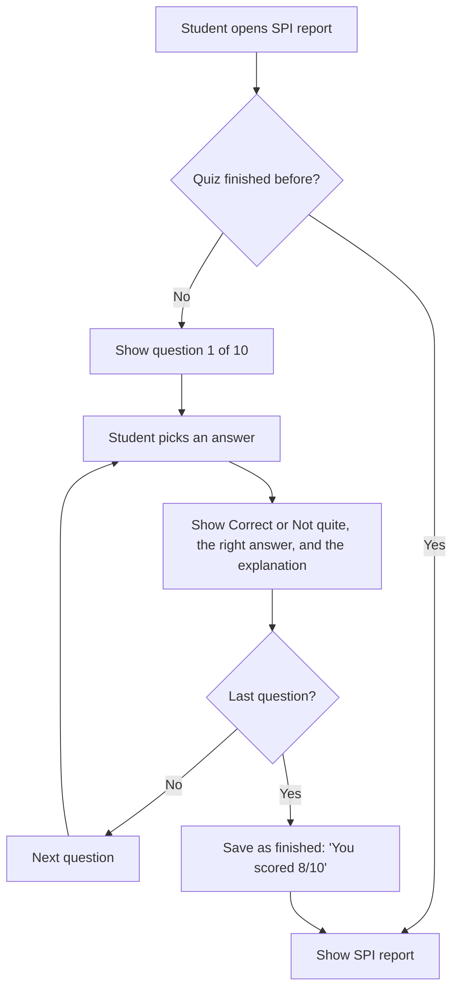

# SPI Awareness Quiz: plan

Prepared for: the SPI report project, for review with the Project POC.
Status: plan only. No code has been changed.
Source for the questions: *NIAT-SPI Execution Plan v1.0* (June 2026).

---

## 1. What we are building

The first time a student opens their SPI report, they take a short **10-question quiz about SPI**. After that they can see the report.

- **Format:** one question at a time, multiple choice (4 options).
- **After each answer:**
  - **Correct:** a green "Correct" message with a short explanation.
  - **Wrong:** a red "Not quite" message, the **correct answer**, and the explanation.
- **Passing:** the student does not have to get every answer right. Finishing all 10 questions unlocks the report.
- **First time only:** once the quiz is finished, the student goes straight to the report every time after that.
- **Tracking:** every attempt and every answer is saved in our **PostgreSQL** database (Replit), so we can report who finished, when, and which questions students get wrong most often.

### Flow

---

## 2. Decisions to confirm with the POC

| # | Decision | Recommendation |
|---|---|---|
| 1 | Must the student pass, or only finish? | **Only finish.** The quiz is for awareness, not a test. A pass mark would block students from their own data. |
| 2 | Can students skip the quiz? | **No skip button.** It's only 10 questions. |
| 3 | Same questions for everyone, in the same order? | **Same 10 questions; shuffle the answer options** so students can't share "the answer is always B". |
| 4 | Is the quiz once ever, or once per skill cycle (semester)? | **Once ever** for now, as asked. Each record stores a quiz version, so a new quiz can be shown later (for example when the policy changes) without losing history. |
| 5 | Do staff (BOA, admin) see the quiz when they open a student's report? | **No.** Staff go straight to the report. Only students see the quiz, and only student answers are saved. |
| 6 | If a student closes the page halfway, what happens? | **Resume from the next unanswered question.** Answers already given are kept. |
| 7 | Can a student change an answer after submitting it? | **No.** The first answer is final, and the explanation is shown right after. |

---

## 3. The 10 questions

The questions are written in simple English and use only rules stated in the Execution Plan. They avoid **course weights** (not final yet) and **Skill Assessment / Final scores** (data not available yet), so nothing in the quiz contradicts the report.

**Q1. What does SPI stand for, and what is it scored out of?**
- A. Student Progress Index, out of 100
- **B. Skill Performance Index, out of 10** ✅
- C. Skill Placement Indicator, out of 5
- D. Student Performance Index, out of 100

*Explanation:* SPI is the **Skill Performance Index**. It is a score from **0 to 10** that shows how ready you are in the skills taught across all your courses. *(Plan §1.3)*

**Q2. What attendance do you need to stay eligible for SPI?**
- A. 75% overall across all courses
- B. 80% overall across all courses
- **C. At least 80% in every course** ✅
- D. 60% in every course

*Explanation:* You need **at least 80% attendance in each course**, not just on average. One course below 80% means the attendance condition is not met. *(Plan §4)*

**Q3. Which assessment counts the most towards your course score?**
- A. Classroom Quizzes
- B. Module Quizzes
- C. Skill Assessments
- **D. Final Skill Assessment** ✅

*Explanation:* The **Final Skill Assessment counts for 50%** of the course score. Classroom Quizzes count 10%, Module Quizzes 15% and Skill Assessments 25%. *(Plan §3.1)*

**Q4. You miss one Classroom Quiz. What happens?**
- A. Nothing, as long as your other quiz scores are good
- **B. It is recorded as Absent (0 points), and you don't meet the 100% participation rule** ✅
- C. Your average is calculated without that quiz
- D. You can take it any time before the Final

*Explanation:* Classroom Quizzes need **100% participation**. A missed quiz is recorded as **Ab (0 points)** and counts against your eligibility. A recovery quiz may be offered only for genuine absences. *(Plan §4)*

**Q5. Your course score is 84%. What level and points do you get?**
- A. A+ and 10 points
- **B. A and 9 points** ✅
- C. B and 8 points
- D. A and 8 points

*Explanation:* **80–89.99% is level A, worth 9 points.** 90–100% is A+ (10 points), and 70–79.99% is B (8 points). *(Plan §3.2)*

**Q6. What happens if your course score is below 50%?**
- A. You get level D and 6 points
- B. You get half points
- **C. You get level F, 0 points, and it creates a Skill Debt** ✅
- D. The course is left out of your SPI

*Explanation:* **Below 50% is level F: 0 points and a Skill Debt.** Being absent gives level Ab, which is also 0 points and a Skill Debt. *(Plan §3.2)*

**Q7. Your attendance in a course drops below 80%. What happens first?**
- A. You get a Skill Debt immediately
- **B. You are placed in Recovery Mode and given recovery classes** ✅
- C. You are removed from the course
- D. Nothing until the end of the semester

*Explanation:* Below 80% puts you in **Recovery Mode**. You get **recovery classes after college hours**, and your benefits continue while you recover. Once you reach 80%, Recovery Mode ends. *(Plan §7.1, §7.2)*

**Q8. You are in Recovery Mode and skip your assigned recovery classes. What happens?**
- A. You get a warning email only
- B. Your attendance target drops to 60%
- **C. The course becomes a Skill Debt and NIAT activities are paused** ✅
- D. Nothing, recovery classes are optional

*Explanation:* Skipping assigned recovery classes **turns the course into a Skill Debt**. You also become ineligible for assessments and your NIAT activities are paused. *(Plan §6.1, §7.2)*

**Q9. Which of these are paused while you have an active Skill Debt?**
- A. Only placements
- B. Only MINT and BRAVE
- **C. MINT, BRAVE, GRIT, placements, internships and co-curricular support** ✅
- D. Nothing is paused; it only lowers your SPI

*Explanation:* An active Skill Debt pauses **MINT, BRAVE, GRIT, placement drives, internship nominations and co-curricular support** until every Skill Debt is cleared. *(Plan §6.2)*

**Q10. How long do you have to clear a Skill Debt?**
- A. 1 month
- B. Until the end of the semester
- **C. 2 years** ✅
- D. There is no time limit

*Explanation:* A Skill Debt must be cleared **within 2 years**. You clear it by attending recovery classes, finishing pending work and re-taking the Final Skill Assessment with at least 50%. After 2 years there is a mandatory review. *(Plan §6.2, §6.3)*

> Optional extra question, if one should be swapped in: *"You miss a session for a medical reason. What should you do?"* Answer: inform COS/PM and submit proof (such as a medical certificate) **within 5 days**. *(Plan §4.1)*

---

## 4. Database design (PostgreSQL on Replit)

The new tables would go next to the existing ones in `lib/db/src/schema/` (same style as `attendance_requests` in `brave.ts`) and be created with the existing `pnpm --filter @workspace/db run push`.

### Table 1: `spi_quiz_attempts` (one row per student per quiz version)

| Column | Type | Meaning |
|---|---|---|
| `id` | uuid, primary key | |
| `student_id` | text, not null | Same student ID the report uses (`/spi/<studentId>`) |
| `student_name` | text | Saved at start, for easy reporting |
| `campus` | text | Saved at start, for campus-wise reports |
| `quiz_version` | text, not null | For example `v1-2026-10`. Lets us run a new quiz later. |
| `status` | text | `in_progress` or `completed` |
| `correct_count` | integer | 0–10, filled when completed |
| `started_at` | timestamptz | |
| `completed_at` | timestamptz, null until done | |

There is a **unique index on (`student_id`, `quiz_version`)**, so a student can never have two attempts for the same quiz. This is what makes it "first time only".

### Table 2: `spi_quiz_answers` (one row per question answered)

| Column | Type | Meaning |
|---|---|---|
| `id` | uuid, primary key | |
| `attempt_id` | uuid → `spi_quiz_attempts.id` | |
| `question_id` | text | For example `q05-level-points` |
| `selected_option` | text | The option the student picked |
| `is_correct` | boolean | Worked out **on the server**, not trusted from the browser |
| `answered_at` | timestamptz | |

There is a **unique index on (`attempt_id`, `question_id`)**, so each question can be answered only once.

### Where the questions live

The 10 questions, options, correct answers and explanations go in **one file in the API server**, for example `artifacts/api-server/config/spi-quiz-v1.json`, in the same style as `attendance-exclusions.json`. They don't need a database table, because they change rarely and should be reviewed like code.

---

## 5. API endpoints (planned)

All endpoints use the **same access check as the report** (`canAccessStudent` in `artifacts/api-server/src/routes/attendance.ts`). A student can only see and answer their own quiz. The **correct answers are never sent to the browser before the student answers**, so they can't be read from the page.

| Endpoint | What it does |
|---|---|
| `GET /api/spi-quiz/:studentId/status` | Returns `{ required, completed, nextQuestion, correctCount }`. The report page calls this first. |
| `GET /api/spi-quiz/:studentId/questions` | Returns the 10 questions with their options (shuffled), **without** correct answers |
| `POST /api/spi-quiz/:studentId/answer` | Body `{ questionId, option }`. Saves the answer and returns `{ isCorrect, correctOption, explanation }`. |
| `POST /api/spi-quiz/:studentId/complete` | Allowed only after all 10 answers are saved. Marks the attempt completed and returns the score. |
| `GET /api/admin/spi-quiz/summary` (staff only) | Completion count by campus and the percentage correct per question, for tracking |

The **report endpoints should also check completion on the server**. Until the student finishes the quiz, `/overview`, `/subjects` and `/quizzes` return `403 quiz_required` for student (token) access. Without this check, a student could skip the quiz by calling the API directly. Staff sessions are not affected.

---

## 6. Screen changes (planned)

- **`SpiReport.tsx`:** before showing the report, call the status endpoint.
  - **If the quiz isn't finished:** show the quiz screen.
  - **Otherwise:** show the report, as today.
- **New `SpiQuiz.tsx` component:**
  - **Header:** "Before you see your SPI report: 10 quick questions about how SPI works", with a progress bar showing "Question 3 of 10".
  - **Question:** the four options as large tap-friendly buttons (works on mobile), with a **Submit** button.
  - **After submitting:** the answer turns green or red, and the correct answer is highlighted with the explanation below. A **Next** button moves on.
  - **Finish screen:** "You scored 8 / 10. You can now view your SPI report", with an **Open my report** button.
- **Same NxtWave colours and simple English** as the v4 scorecard.

---

## 7. Tracking and reports

Because every answer is saved, we can show staff:

- **Completion:** how many students finished the quiz, by campus, and how many have not started yet.
- **Average score:** across all students who finished.
- **Hardest questions:** the percentage of students who got each question right. This shows which SPI rules students misunderstand, so BOAs know what to explain in class.
- **Timing:** when students finished, which shows how quickly the report is being opened after it is shared.

To begin with, this can be a simple table on an existing admin page or a CSV export. A full dashboard can come later.

---

## 8. Edge cases

| Case | Handling |
|---|---|
| Student refreshes or closes the page mid-quiz | Resume at the next unanswered question. Earlier answers are kept. |
| Two tabs open at once | The unique indexes stop double answers. The second tab shows the saved result. |
| Link opened by a parent or friend | They see the quiz too (the link is the only identity today). Once the report moves to Learning Portal SSO, this is solved. |
| Policy changes later | Add `spi-quiz-v2.json` and a new `quiz_version`. Decide whether students must take it again. |
| Staff opening a student's report | No quiz, and nothing is saved. |
| Student with no report data (404) | Show the error first; don't show a quiz for a report that can't load. |

---

## 9. Build steps and effort

| Step | Work | Effort |
|---|---|---|
| 1 | POC approves the questions and the decisions in section 2 | — |
| 2 | Add the two tables to the Drizzle schema and run `db push` | S |
| 3 | Question file and the 4 API endpoints, plus the server-side check on the report endpoints | M |
| 4 | Quiz screen and the gate in `SpiReport.tsx` | M |
| 5 | Staff summary (table or CSV) | S |
| 6 | Testing: first visit, resume, repeat visit, staff view, mobile | S |

Overall effort: **about M**, roughly 2–3 working days for one developer, after the questions are approved.

---

## 10. Questions for the POC

1. Is finishing the quiz enough, or must students reach a minimum score?
2. Once ever, or once per skill cycle?
3. Are these 10 questions approved, and does anyone in Academics need to review them?
4. Should staff be able to reset a student's quiz (for example after a policy change)?
5. Who needs the tracking report (BOA, Training Team, HOD), and how often?
