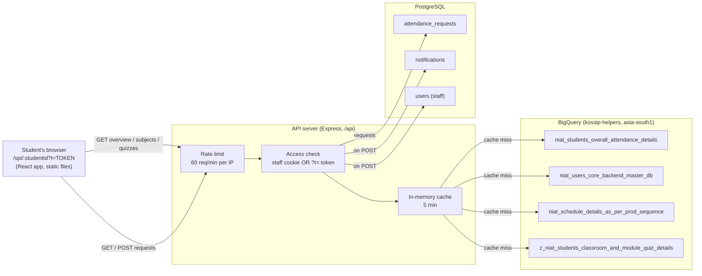

# Student SPI Report: integration brief

Prepared for: a Product Manager meeting about showing our student SPI report inside another application.
Checked against the code on branch `syam-new` (commit `5f7edd1`). Read-only review: no code was changed. File references are relative to the repository root.

---

## Summary (5 lines)

1. The report (`/spi/<studentId>?t=<token>`) is a read-only page for one student. It shows attendance by course, quiz completion and a provisional SPI score, and it lets the student ask for an attendance correction.
2. It reads live data from BigQuery (attendance, schedule and quiz tables) through our API. The API keeps each answer for 5 minutes in server memory. Correction requests are saved in our PostgreSQL database.
3. Anyone who has the link can open it without logging in. The link carries a signed token that is valid for 90 days. Nothing stops anyone from forwarding the link.
4. The SPI number is provisional. Only Classroom quizzes (10%) and Module quizzes (15%) are counted, so today no student can score more than 2.5 out of 10. The big "Eligible" label at the top looks only at attendance.
5. The fastest way to integrate is Option A, a button that opens our signed link. To do that we must first build a safe way for the other app to get a link for each student. Embedding the page in an iframe (Option B) and a JSON API (Option C) are both possible, but each needs more work and more security decisions.

---

## 1. What the report shows

The page is built from two files:
- `artifacts/niat-spi-dashboard/src/pages/SpiReport.tsx` loads the data and handles the correction-request popups.
- `artifacts/niat-spi-dashboard/src/pages/StudentReportView.tsx` draws everything the student sees.

The route is declared at `artifacts/niat-spi-dashboard/src/App.tsx:109`, and it does not require a login.

**Important:** every status, score and rule on the page is worked out **in the browser**, in `StudentReportView.tsx`. The API sends only raw numbers. This matters for Option C (section 4).

### 1.1 Header (name, campus, section, "Updated …")

| What it shows | Where the data comes from | Rule |
|---|---|---|
| Student name | API `/overview` → `studentName` | The largest (`MAX`) `student_name` value among the student's current-semester attendance rows (`artifacts/api-server/src/lib/queries.ts:454-462`) |
| Campus · Section | `/overview` → `instituteName`, `sectionName` | Same query. If the student moved campus this semester, they are shown under their current campus (`artifacts/api-server/src/lib/eligibleStudents.ts:15-19, 54-87`). If a value is missing, the page shows "Campus unavailable" or "Batch / section unavailable" (`StudentReportView.tsx:239-242`). |
| "Updated 14 Oct 2026, 3:05 PM IST · Classes in progress" | **Not from data.** This is the viewer's own clock at the moment the page loads. | `formatUpdated(new Date())` (`StudentReportView.tsx:71-86, 261`). "Classes in progress" is fixed text. See section 2.3. |

### 1.2 SPI eligibility status (the 4-step strip in the header)

- **What it shows:** four boxes: **Eligible (≥80%)**, **Recovery eligible (60–79%)**, **At risk (50–59%)**, **Ineligible (<50%)**. One box is highlighted. Next to the strip is the label "Lowest subject X%", or "Attendance X%" when the student has only one active course.
- **Data:** per-course attendance from `/subjects`.
- **Rule:** the page takes the **lowest attendance % of any course that has sessions recorded** and places it in a band (`StudentReportView.tsx:186-192`; band limits in `artifacts/niat-spi-dashboard/src/lib/attendanceTiers.ts:3-8, 24-53, 66-71, 82-91`).
- **It uses attendance only.** Quizzes, Skill Assessments and the Final are ignored. A student can see **"Eligible"** here while the Classroom and Module Quiz cards say **"NOT MET"** (confirmed, see section 5.3).
- If the student has no courses with sessions yet, the page falls back to overall attendance, which is 0%, so the header shows **Ineligible 0.0%** (`attendanceTiers.ts:87-90`).

### 1.3 The 5 cards

All five are in `StudentReportView.tsx:327-410`.

| Card | Big number | Badge "MET" when… | Footer | Code |
|---|---|---|---|---|
| **Attendance** | Overall attendance %: present ÷ scheduled across all courses | **Every** course with sessions is at **80% or above** | "present / total sessions · N of M courses at 80%" | `:193-195, 328-345` |
| **Classroom Quizzes** | Completion %: quizzes completed ÷ quizzes assigned | The student has completed **all** assigned quizzes (100%) | "completed / assigned · 10% weight" plus "Avg X%" (average score) | `:196-199, 346-362` |
| **Module Quizzes** | The same, for module quizzes | 100% completed | "… · 15% weight" plus "Avg X%" | `:197-200, 363-379` |
| **Skill Assessments** | Always "—" | Always "UPCOMING" | "Opens [Date TBA] · 25% weight" (placeholder text visible to students) | `:380-394` |
| **Final Assessment** | Always "—" | Always "UPCOMING" | "Opens [Date TBA] · 50% weight" | `:395-409` |

How the quiz numbers are made (`artifacts/api-server/src/lib/queries.ts:4866-4949`):
- The quiz table has **one row per student, per course, per quiz type** (classroom or module). It holds totals, not individual quizzes.
- "Completed" is the sum of `total_completed_quizzes`. "Assigned" is the sum of `total_quizzes`.
- "Avg" is a **simple average of the per-course average scores**. Every course counts the same, whatever its quiz count. A course with no attempts counts as **0%** (`:4930-4940`).
- When nothing is assigned, the card shows "—" with a **NOT MET** badge (`StudentReportView.tsx:198-200, 351`).

### 1.4 SPI score (the ring, "X.X out of 10")

- **Data:** Classroom Avg and Module Avg from `/quizzes`.
- **Formula** (`artifacts/niat-spi-dashboard/src/lib/spiScore.ts:14-27`, called at `StudentReportView.tsx:201`):

  `SPI % = (Classroom avg × 10 + Module avg × 15 + Skill × 25 + Final × 50) ÷ 100`, then `SPI points = SPI % ÷ 10`

  Skill and Final are always passed as **0**, so **the highest score anyone can get today is 2.5 / 10**.
- **Colour:** green at 7 or above, amber at 5 or above, otherwise red (`StudentReportView.tsx:202-203`). Since nobody can pass 2.5 today, **the ring is red for every student**.
- **"Provisional" note:** shown unless attendance, Classroom quizzes and Module quizzes are all met (`:204, 421-425`).

### 1.5 Next steps

`StudentReportView.tsx:207-229, 428-457`. Up to 3 to-do items, built in this order:
1. If any course is below 80%: "Attend recovery classes for N courses. Skipping them turns the course into a Skill Debt."
2. If classroom quizzes are incomplete: "Complete N classroom quizzes."
3. If module quizzes are incomplete: "Complete N module quizzes before the Final Skill Assessment."

If none of these apply, it shows "You're on track — keep attending every class."

### 1.6 Course attendance table

`StudentReportView.tsx:152-176, 461-556`. Data comes from `/subjects`.

- **Which courses appear:** every course on the student's **timetable** (the prod-sequence schedule for their current-semester sections), plus any course they have attendance records for (`queries.ts:516-612`).
- **What is left out:** Physics, Chemistry, Others and Indian Knowledge System CSC are excluded (`artifacts/api-server/config/attendance-exclusions.json`). Rows with no course name and the "intensive offline dc" campus are also excluded (`queries.ts:294-295`, `artifacts/api-server/src/lib/excludedInstitutes.ts:2`).
- **Which sessions count:** current semester only, session slots only, dated up to today in IST (`queries.ts:291-293`).
- **Columns:**
  - **Sessions:** present / scheduled.
  - **Attendance %:** present ÷ scheduled, rounded to 1 decimal (`queries.ts:404`, `artifacts/api-server/src/lib/bigquery.ts:632-635`).
  - **Submitted only:** present ÷ slots where the instructor actually submitted attendance (`queries.ts:405`). This shows how much of the gap comes from attendance that was never submitted.
  - **Short of 80%:** how many more sessions in a row the student must attend, with no further absences, to reach 80% (`attendanceTiers.ts:94-104`).
  - **Status:** the same 4 bands as the header.
- **Order:** lowest % first. Courses not started yet go to the bottom (`StudentReportView.tsx:152-163`).
- **"NOT STARTED"** means no sessions have been held yet. **"NO RECORDS"** means sessions were held but the student has no attendance rows, which is shown with a data warning (`:731-739`).
- **⚠ warning icon** ("may be a data issue"): appears when a course is at 0% or its name ends in "quizzes" (`:106-109`).
- **Total row:** the same totals as the Attendance card.

### 1.7 Skill Debt section

`StudentReportView.tsx:231-237, 558-616`.

- **Badge:** shows **"Skill Debt"** when **either** of these is true:
  - (a) the student has **no classroom and no module quizzes assigned at all**, or
  - (b) the lower of Classroom Avg and Module Avg is **below 50%**.

  Otherwise it shows "No active Skill Debts". This matches the "F / Ab" rule on the staff SPI Record page (`queries.ts:1215-1223`).
- **Fixed explanatory text:** what creates a debt (skipping recovery classes, scoring below 50% in the Final, not meeting eligibility), what gets paused (MINT, BRAVE, GRIT, Placements, Internships, Co-curricular support), and that debts must be cleared within 2 years. Only "Skip assigned recovery classes · applies to you now" changes with the data: it appears when any course is below 80%.
- **Note:** the badge rule (quiz averages) is **not** the rule the page's own text describes (recovery classes, Final score). See section 5.5.

### 1.8 Attendance correction button

The **"Request attendance correction"** and **"My requests (N pending)"** buttons are at `StudentReportView.tsx:303-318`. The popups and logic are in `SpiReport.tsx:478-650, 981-1310`.

- The student picks 1 to 10 past dates and can add an optional reason (up to 500 characters), then sends the request.
- The server checks the request (`artifacts/api-server/src/routes/attendance.ts:178-217`):
  - Dates must be in YYYY-MM-DD format.
  - Future dates are rejected. "Today" is measured in UTC, so between 00:00 and 05:30 IST today's IST date counts as a future date.
  - Duplicate dates are dropped.
  - A date that already has a pending request is refused with "409" (`:442-460`).
- The request is saved in **PostgreSQL** in the `attendance_requests` table (`lib/db/src/schema/brave.ts:82-104`). A notification is sent to every active superadmin and admin, and to the BOA users of the student's campus (`attendance.ts:474-505`).
- Staff approve or reject requests on the Attendance Requests page (`artifacts/api-server/src/routes/notifications.ts:255-330`). **Approving a request changes only its status in PostgreSQL. It does not change the attendance numbers on the report.** Those numbers come from BigQuery, which this app never writes to.
- "My requests" lists all of the student's requests with each date's status: Pending, Verified, Rejected or Partial (`SpiReport.tsx:1425-1459`).

### 1.9 Code that is never shown

`SpiReport.tsx` also works out a second SPI ring, an eligibility checklist, a "Clear / Recovery / Skill Debt" banner, quiz detail panels and a per-course session list (`SpiReport.tsx:131-396, 731-833, 867-979, 1461-1706`). **None of this reaches the screen:** none of it is passed to `StudentReportView`, and nothing on the page opens the side panel. The `/recent` endpoint is therefore never called. That code also contains a comment saying Skill Debt should **not** be inferred from quiz averages (`:821-826`), which contradicts what the visible page does. It is leftover code and should not be used to describe the product.

---

## 2. Architecture and data flow

### 2.1 Diagram



### 2.2 Endpoints the report calls

All endpoints are under `/api/attendance/students/{studentId}/…` and are defined in `artifacts/api-server/src/routes/attendance.ts`. Every one of them:
- checks that the student ID has 4 to 64 letters, digits, `-` or `_` (`bigquery.ts:620`),
- applies the rate limit (`attendance.ts:42-47`),
- checks access (`attendance.ts:166-174`).

Only the first four are described in `lib/api-spec/openapi.yaml:112-217`. The `requests` endpoints are called with plain `fetch` and are not in the API spec.

| Endpoint | Called when | Response (main fields) | Data behind it | Code |
|---|---|---|---|---|
| `GET /overview?t=` | Page load | `{ studentId, studentName, instituteName, sectionName, totalSessions, presentCount, absentCount, attendancePct, inRecovery, coursesInRecovery }`. Returns 404 if the student has no current-semester attendance. | BQ attendance table (through the eligible-students filter, which joins the student master table) plus everything `/subjects` uses | `attendance.ts:246-278`, `queries.ts:441-485` |
| `GET /subjects?t=` | Page load | Array of `{ subjectTitle, courseCategory, present, total, pct, meetsRequirement, submitted, presentSubmitted, pctSubmittedOnly, sessionsHeld }` | BQ attendance + prod-sequence schedule + student master | `attendance.ts:280-308`, `queries.ts:270-312, 516-612` |
| `GET /quizzes?t=` | Page load | `{ classroomQuizzes[], moduleQuizzes[], classroomSummary{attempted,total,avgPct}, moduleSummary{…} }`. Each item: `{ subjectTitle, title, score (=completed), maxScore (=assigned), percentage, status, date:null }` | BQ quiz table only | `attendance.ts:340-368`, `queries.ts:4866-4949` |
| `GET /requests?t=` | Page load (for the pending count) and when "My requests" is opened | Array of `{ id, studentId, studentName, campus, dates[{date,reason,status,…}], overallStatus, createdAt }` | PostgreSQL `attendance_requests` | `attendance.ts:371-406` |
| `POST /requests?t=` | When the student submits a request | Body `{ dates:[{date,reason}] }`. Returns 201 with the saved request plus `notifiedCount`. | PostgreSQL `attendance_requests`, `notifications`, `users`. Also calls `/overview` logic to get the student's name and campus. | `attendance.ts:411-522` |
| `GET /recent?t=` | **Never** (see 1.9) | Up to 500 `{ date, sessionTitle, subjectTitle, attendanceStatus, markingMethod }` | BQ attendance | `attendance.ts:310-338`, `queries.ts:622-654` |

Full BigQuery table names:
- Attendance: `kossip-helpers.niat_post_onboarding_engagement_ai_analytics_workspace.niat_students_overall_attendance_details` (`artifacts/api-server/src/lib/attendance-contract.ts:3-4`)
- Student master: `…niat_users_core_backend_master_db` (`eligibleStudents.ts:21-22`)
- Schedule: `…niat_schedule_details_as_per_prod_sequence` (`bigquery.ts:6-7`)
- Quizzes: `…z_niat_students_classroom_and_module_quiz_details` (`queries.ts:68-69`)

Student IDs are matched without hyphens and in lowercase, because the attendance table stores UUIDs with hyphens and the quiz table stores them without (`queries.ts:60-67`, `bigquery.ts:621-630`).

### 2.3 Caching, freshness, and what "Updated" means

- **Server cache:** a simple in-memory store (`artifacts/api-server/src/lib/cache.ts`). `/overview`, `/subjects`, `/quizzes` and `/recent` each keep an answer for **5 minutes** per student (`attendance.ts:271, 301, 331, 361`). The course-attendance query underneath has its own 5-minute cache (`queries.ts:327-346`). The worst case is therefore a little under 10 minutes on top of BigQuery's own delay. **The cache resets when the server restarts.** The app is deployed on Replit "autoscale" (`.replit`), so different server copies may each hold their own slightly different snapshot for a few minutes.
- **`/requests` is never cached.** A new correction request shows up immediately.
- **Browser cache:** React Query with default settings (`App.tsx:45`). It reloads the data when the student comes back to the browser tab. Failed calls are retried 3 times before the error screen appears.
- **How fresh the data is:** it can never be fresher than the BigQuery tables. **Our code does not control or know when those tables are refreshed.** That is set by the data team's pipelines.
- **"Updated <time>" label:** this is the **time on the viewer's own device when the page loaded**, shown in IST (`StudentReportView.tsx:71-86, 261`). **It is not the time the data was refreshed.** Every reload shows the current time, even if the BigQuery tables are days old. A PM should not present it as a data timestamp.

---

## 3. Access and security

### 3.1 How the signed link works

Everything below is in `artifacts/api-server/src/lib/spiToken.ts`.

- **Link format:** `/spi/<studentId>?t=<exp>.<signature>`.
  - `exp` is the expiry time as a Unix timestamp in seconds.
  - `signature` is HMAC-SHA256 of the text `spi:<studentId>:<exp>`, encoded as base64url (`:7-11, 24-28`).
- **Secret:** `JWT_SECRET` from the server environment. If it is missing, the code falls back to the built-in value `"dev-secret-change-me"` (`:3`). **The same secret signs staff login sessions** (`artifacts/api-server/src/lib/auth.ts:6, 20-22`).
- **Expiry:** 90 days from creation (`:5`).
- **How the token is checked:** the server recomputes the signature for that student and expiry, compares the two in constant time, and rejects the token if the expiry has passed (`:36-50`). A token signed for one student does not work for another.
- **Legacy tokens:** a token with no `.` is accepted as an old-style **permanent** link with no expiry (`:52-54`). Any such link handed out in the past still works and can never expire.
- **Cannot be revoked:** there is no way to cancel one link. The only way is to change `JWT_SECRET`, which cancels **every** link and logs out every staff user.
- **Where links come from:**
  - Staff pages put links next to student names. A new 90-day link is made on every page load (`spiSharePath`, used in `routes/dashboard.ts`, `routes/notifications.ts` and `routes/attendance.ts:602`).
  - Any logged-in staff user can also call `POST /api/attendance/spi-token` with `{studentId}` and get `{token, expiresAt, shareUrl, apiUrl}` (`attendance.ts:66-91`).
  - **There is no automatic way for students to receive their link.** No student login, email or SMS exists in this code.
- **Rate limit:** **60 requests per minute per IP address**, shared across all the student endpoints (`attendance.ts:42-47`). The counter is kept in memory, per server copy. One page load uses 3–4 requests, so roughly **15 page loads per minute from one IP** hit the limit. **Students on one campus Wi-Fi often share one public IP address**, so a whole class opening the report together may get errors.

### 3.2 Who can open the report

The rule is in `attendance.ts:166-174` and `artifacts/api-server/src/lib/studentAccess.ts`.

| Visitor | Result |
|---|---|
| Anyone with a valid, unexpired link (no login) | Full access to that one student's report, including submitting correction requests on the student's behalf |
| Staff logged in as superadmin, admin or HOD | Any student, with or without a token |
| Staff logged in as BOA, capability manager or instructor | Only students whose current campus is one of the user's campuses (`studentAccess.ts:27-36`) |
| **Staff logged in whose campus does not match, even with a valid link** | **Refused (403).** When a staff login cookie is present, the token is ignored completely (`attendance.ts:170-172`). |
| No login and no token, or a wrong token | Refused (403) |

### 3.3 When a token is expired or wrong

The API returns `403 Forbidden`. The page retries 3 times (a few seconds), then shows **"We couldn't load this report. Check the link and try again."** with a "Try again" button (`SpiReport.tsx:690-711`). There is no message saying the link has *expired*, and no way to request a new link. A student with no current-semester attendance gets a 404, which shows the same message.

The Landing page links to `/spi/demo` (`artifacts/niat-spi-dashboard/src/pages/Landing.tsx:148, 437`). There is no demo data on the server, so visitors who are not logged in get this error page.

### 3.4 Risks when the link is shared or embedded

1. **The link is the password.** Whoever has it can see the student's name, campus, attendance and quiz results, and can submit correction requests in the student's name, for up to 90 days (or forever, for legacy links). Forwarded links, screenshots of the address bar, browser history and shared devices all leak it.
2. **Any staff user can make a link for any student**, including students outside their own campus, through `POST /spi-token`. This endpoint checks only that the user is logged in, not which campuses they cover (`attendance.ts:66-91`).
3. **One secret for two jobs.** If `JWT_SECRET` is ever given to another team so they can make links, they could also forge staff logins, including admin. **Never share this secret with the other app.**
4. **The page can be framed by any website.** Our server sets no `X-Frame-Options` or `Content-Security-Policy frame-ancestors` header (`artifacts/api-server/src/app.ts`; the front end is served as plain static files, `artifacts/niat-spi-dashboard/.replit-artifact/artifact.toml`). We have not checked whether Replit's hosting adds one. As things stand, any site could embed a student's report or trick a student into clicking the correction button ("clickjacking").
5. **The token travels in the URL.** Our API logs strip the query string (`app.ts:20`), but proxies, browser history and analytics tools in another app may keep the full URL.
6. **`robots.txt` allows all pages** (`artifacts/niat-spi-dashboard/public/robots.txt`). If a link is ever posted publicly, search engines may index it.

---

## 4. Integration options

### How the other app can match its students to our `studentId`

Our `studentId` is the NxtWave platform **user ID** (a UUID). It is the `student_user_id` in the attendance table and the `user_id` in the student master table (`eligibleStudents.ts:37-45`). Hyphens and upper/lower case do not matter (`bigquery.ts:621-630`).
- **If the other app already stores the same NxtWave user ID**, no mapping is needed.
- **If it does not**, it needs a mapping table, for example by email, phone or roll number. Our code reads only `user_id` and `institute_name` from the master table. Which other identifiers that table holds must be confirmed with the data team.
- A student with no current-semester attendance gets a 404 (no report), even if their ID is valid.

### Option A: a link or button in the other app that opens our signed link

**What must be built:** the other app needs a valid link for each student, and today it has no safe way to get one.
- `POST /spi-token` needs a staff browser login, so it cannot be called from another server.
- Sharing `JWT_SECRET` is unsafe (risk 3.4-3).

Choices:
1. **(Recommended) A service endpoint:** for example `POST /api/integrations/v1/spi-link`, protected by an API key or client credentials issued only to the other app. It returns `{ url, expiresAt }`. The other app calls it **from its server** when a student clicks the button, and never stores the link.
2. **Bulk export:** a nightly file of `studentId → link` pairs. This is simpler, but the links pile up and can leak.

Also needed:
- shorter expiry for these links (for example 1 hour to 1 day),
- a separate signing secret (not `JWT_SECRET`),
- a clear "link expired" screen,
- a rate limit that does not punish shared campus IPs.

**Effort:** S for the link endpoint, M with the hardening above.

**Risks:**
- links are forwarded (3.4-1);
- the 60-per-minute-per-IP limit on campus Wi-Fi;
- staff who are logged in to our dashboard in the same browser may get 403 because the token is ignored (3.2);
- the page opens as a separate full-screen site with our branding and fonts.

### Option B: embedding the page in an iframe

**What must be built or changed:**
- **Headers:** add `Content-Security-Policy: frame-ancestors 'self' https://<other-app-domain>`. This stops every other site from framing the page and closes risk 3.4-4. It must be set on the static front-end responses. The API's Express app does not serve the page, so we must check how Replit static hosting lets us set headers.
- **Getting a link:** the same as Option A. The iframe `src` is the signed link.
- **Cookies:** none are needed for the token path. Our staff cookie is `SameSite=Lax` (`auth.ts:59-67`), so browsers will **not** send it inside another site's iframe. That is good here: the token path is used and the "staff session ignores token" problem goes away.
- **CORS:** not needed. The page in the iframe calls our own `/api` on the same domain. The current CORS allowlist (`app.ts:32-57`) does not matter for the iframe.
- **Layout:** the page assumes it fills the whole screen (`min-h-screen`, its own grey background, wide desktop layout). Its popups open inside the iframe. It works on mobile widths, but the other app must give it enough height or allow scrolling inside the frame. The "learning.support@" email link opens the viewer's mail app.

**Effort:** M (headers + link service + layout testing).

**Risks:**
- the same token-leak risks as A;
- the iframe URL (with its token) may end up in the other app's logs and analytics;
- two brands and styles on one screen;
- if the other app is a mobile app with a webview, check that its cookie and storage rules do not break the page;
- browser privacy features may change iframe behaviour over time.

### Option C: a JSON API so the other app builds its own screen

**Important:** the API sends only raw numbers today. The eligibility band, MET/NOT MET, the SPI score, Skill Debt and Next steps are all **worked out in the browser** (`StudentReportView.tsx:186-237`, `spiScore.ts`). If the other app copies those rules itself, the two products will drift apart every time a rule changes, and the rules are still changing (section 5).

**What must be built:**
- **One new versioned endpoint**, for example `GET /api/integrations/v1/students/{studentId}/spi-report`. It returns final values that are ready to display:

  ```
  { studentId, name, campus, section,
    dataAsOf,                         // real freshness time, needs a data-team source
    attendance: { overallPct, lowestCoursePct, band, met, courses: [...] },
    quizzes: { classroom: {completed, assigned, avgPct, met}, module: {...} },
    spi: { points, maxPossibleToday: 2.5, provisional: true, components: [...] },
    skillDebt: { active, reasons: [...] },
    nextSteps: [...],
    rulesVersion: "2026-10" }
  ```

- **Move the calculations from the browser to the server**, so that our page and the other app use the same code.
- **App-to-app login:** for example OAuth2 client credentials or an API key, with an IP allowlist, a rate limit **per client** instead of per IP, and an audit log. Calls should go **server to server only**, with no CORS opening.
- **Versioning:** keep `/v1` stable. Add fields without removing any. Breaking changes go into `/v2` with notice. Include `rulesVersion` so the other app can tell when SPI rules change.
- **Corrections:** decide whether the other app may also send correction requests. That would need a `POST` endpoint that records which app sent the request.

**Effort:** L.

**Risks:**
- the most work;
- the other team now owns a display that must stay correct;
- a server-to-server caller would hit today's 60-per-minute-per-IP limit at once (all calls come from one IP);
- the BigQuery cost and speed of calling this for many students in bulk;
- a 5-minute cache that differs between server copies.

---

## 5. Known limitations and gaps

### 5.1 SPI is provisional and capped at 2.5 / 10

**Confirmed.** Skill Assessments (25%) and the Final (50%) are not in any data source the report reads. Both are fixed at 0 (`StudentReportView.tsx:201`, `spiScore.ts:4-12`). Their cards show "UPCOMING" and the placeholder text "Opens [Date TBA]" (`StudentReportView.tsx:390, 405`). Because the formula always divides by the full 100 (`spiScore.ts:24-26`), the highest score possible today is **2.5 / 10**, and the colour rule (red below 5) makes **every student's SPI red**.

### 5.2 SPI scoring compared with the NIAT-SPI policy

The policy document is **not in the repository**, so I can only describe what the code does:
- The report's SPI uses **raw average percentages × category weights (10/15/25/50) ÷ 100 ÷ 10** (`spiScore.ts:24-26`). The staff pages use the same formula (`queries.ts:1018-1021`, `artifacts/api-server/src/lib/spiRecordAggregate.ts:29-31`).
- **No level points are used in the score.** A mapping from level to points exists (≥90 → 10, ≥80 → 9, ≥70 → 8, ≥60 → 7, ≥50 → 6, <50 → 0) in `queries.ts:1225-1232` and `spiRecordAggregate.ts:44`. It is used only for the "Classroom/Module points" columns on the staff SPI Record page, not in any SPI score.
- **No course weights and no "÷ 22" appear anywhere in the code.** Every course counts the same in the quiz averages (`queries.ts:4934-4939`).
- **If the policy says "convert each course to level points, weight by course credits, divide by 22", the current number does not follow it.** This needs a decision before another app shows the number.

### 5.3 "Eligible" in the header while quizzes show "Not met"

**Confirmed: the header looks at attendance only.** It uses the lowest course attendance % (`StudentReportView.tsx:186-192`) and ignores quizzes, Skill Assessments and the Final. The cards below apply 100% quiz-completion rules (`:198-200`). The "Provisional" note under the SPI ring is the only place that combines all three (`:204, 421`). A student can therefore see a green **"✓ Eligible"** next to red **"NOT MET"** quiz cards.

### 5.4 Campuses with missing data (e.g. Joy, Bharath, Chalapathy CIET)

**This cannot be confirmed from the code.** No campus is handled specially except "intensive offline dc", which is hidden on purpose (`excludedInstitutes.ts:2`). Missing data for a campus comes from the BigQuery tables. The page shows the result in these ways:
- "NO RECORDS" rows (sessions on the timetable, but no attendance),
- "Submitted only: None submitted" (instructors did not submit attendance),
- "—" quiz cards (no quiz rows for the student),
- a 404 error page (no current-semester attendance at all).

Before launch, ask the data team for a coverage check per campus.

### 5.5 Skill Debt shown by a rule that does not match its own text

The badge turns red when the lower quiz average is below 50%, **or when the student has no quizzes assigned at all** (`StudentReportView.tsx:231-237`). So:
- **New students or campuses with no quiz data are shown as being in Skill Debt.**
- A student who has not started this semester's quizzes is shown as being in debt.
- The text next to the badge describes different triggers (skipped recovery classes, the Final score), and the unused code says debt should *not* come from quiz averages (`SpiReport.tsx:821-826`).

The page also lists real consequences ("Placements, Internships paused"), so a wrong badge is serious.

### 5.6 Quiz data is not limited to the current semester

Attendance is current semester only (`queries.ts:291`), but the quiz query has **no semester filter** (`queries.ts:4886-4896`). If the quiz table holds earlier semesters, they are mixed into the averages and the completion counts. We need to confirm with the data team what the table contains.

### 5.7 Quiz average is not weighted

The average treats every course the same, whatever its quiz count, and a course with no attempts counts as 0% (`queries.ts:4930-4940`). Students may read "Avg" as an average over all their quizzes, which it is not.

### 5.8 Approved corrections do not change the numbers

Approving a request only updates PostgreSQL (`notifications.ts:271-330`). The report's attendance comes from BigQuery. Unless someone also fixes the source system, an approved date still shows as absent.

### 5.9 Other things a PM should know

- **The "Updated" time is not a data timestamp** (2.3).
- **Links cannot be cancelled one by one.** Old permanent links still work (3.1).
- **Any staff user can make a link for any student** (3.4-2).
- **Rate limit per IP** may block students on a shared campus network (3.1).
- **Expired links show a generic error** with no next step (3.3). The Landing page's `/spi/demo` link is broken for the public.
- **Physics, Chemistry, Others and IKS CSC are left out** of attendance on purpose (`attendance-exclusions.json`). Students may ask where those courses are.
- **The header says "Ineligible 0.0%"** for a student whose courses have not started (1.2).
- **Hard-coded text:** "Classes in progress", "Opens [Date TBA]" and the support email are written into the page.
- **Leftover code:** about 40% of `SpiReport.tsx` is never shown (1.9) and should not be used as a reference for what the report does.
- **The API spec is incomplete:** the requests and token endpoints are not in `openapi.yaml`. Any API we give another team needs its own proper contract.

---

## 6. Questions to ask the PM

1. **Which option?** A link (A), an embed (B) or their own screen (C)? Is this for students only, or also for staff or parents in the other app?
2. **Identity:** does the other app store the NxtWave user ID? If not, which field should we match on?
3. **Login:** are users already logged in to the other app? If so, should the other app vouch for the student (server-to-server), so that no long-lived link is needed?
4. **Link lifetime:** is 90 days acceptable, or should links last minutes or hours? Should we stop accepting old permanent links?
5. **What do we show while the SPI is provisional?** Should we hide the 0–10 number until Skill Assessments and the Final exist, or show it with the "max 2.5 today" context?
6. **Which SPI formula is official?** The current percentage × weight formula, or the policy's level points with course weights ÷ 22? Who signs it off?
7. **What does "Eligible" mean?** Attendance only, or attendance plus quiz completion?
8. **Skill Debt:** should the page show a debt badge before Final grades and recovery-class data exist? If yes, which rule?
9. **Attendance corrections:** should students be able to request corrections from the other app, and who fixes the source data when a request is approved?
10. **Campus readiness:** which campuses go live first, and who confirms their data is complete?
11. **Volume and timing:** how many students, and are peak times like results day expected? This decides the rate limits and BigQuery cost.
12. **Branding and support:** is our look and the learning.support@ email acceptable inside their product?
